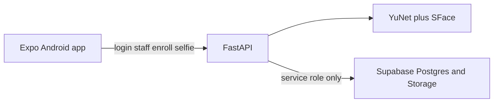

---

Face Attendance App 

overview: Build a small Expo React Native Android app where an admin enrolls staff faces and staff mark attendance with a selfie. A Python FastAPI service runs face detection and matching, and Supabase stores staff, embeddings, selfies, and attendance. todos:

- id: supabase-schema
content: Add schema.sql for staff, face_templates, attendance, and private storage buckets
status: pending
- id: face-backend
content: Build FastAPI login, staff CRUD, YuNet+SFace enroll/match, and Supabase storage writes
status: pending
- id: expo-app
content: Build Expo Android screens for admin staff management, enrollment, and staff selfie attendance with GPS
status: pending
- id: verify
content: Test match, mismatch, and no-face paths, then walk the admin and staff flows
status: pending
isProject: false

---

# Face Attendance App

## Repo choice

The [face-recognition-attendance-system topic](https://github.com/topics/face-recognition-attendance-system) is mostly proprietary SDK demos (KBY-AI, Recognito, Faceplugin). Those need license keys, are not React Native, and several are surveillance or KYC products. They will not be vendored.

Two open repos match this assignment:

- [ntshvicky/FaceRecognitionAttendance](https://github.com/ntshvicky/FaceRecognitionAttendance): phone captures a face, Python backend decides the match. Right split of work, but the app is old Java Android, not React Native.
- [abhash-rai/face-recognition-attendance-system](https://github.com/abhash-rai/face-recognition-attendance-system): detect a face, compute an encoding, compare distance, store the result. Right algorithm, but it is a Jupyter notebook on MySQL and uses `face_recognition`/dlib, which is painful to install on Windows.

We will keep that pipeline and run it in our own backend with OpenCV YuNet (detection) and SFace (128-d embedding, cosine similarity). Both models are Apache-2.0 files from the [OpenCV model zoo](https://github.com/opencv/opencv_zoo). `opencv-python` already includes `FaceDetectorYN` and `FaceRecognizerSF`, so there is no TensorFlow and no dlib. Matching stays 1:1 against the logged-in employee, which is what "their face matches the enrolled face" requires.

On-device React Native models are out of scope because model processing is required to live in Python.

## Architecture

The phone never holds the Supabase service key. It talks only to FastAPI. FastAPI uses the service role for Postgres and Storage.

Dummy logins, checked by the API:

- Admin: username `admin`, password `admin123`
- Staff: employee ID plus shared password `staff123`

A staff session is bound to that employee. Attendance compares the new selfie only to that employee's enrolled embedding. A mismatch does not insert a row.

## Data

New file [supabase/schema.sql](supabase/schema.sql), applied once in the Supabase SQL editor:

- `staff`: `id`, `name`, `employee_id` unique, `created_at`
- `face_templates`: one row per staff, `embedding` as jsonb (128 floats), `image_path`
- `attendance`: `staff_id`, `marked_at`, `selfie_path`, `latitude`, `longitude`, `similarity`
- Storage buckets `enrollments` and `attendance-selfies` (private; the API returns signed URLs when a screen needs a photo)

No Supabase Auth. Roles live in the API token (a short-lived signed token with `role` and `staff_id`).

## Python backend

[backend/](backend/) FastAPI app:

- `POST /login`
- `GET /staff`, `POST /staff`, `GET /staff/{id}`
- `POST /staff/{id}/enroll` (admin, multipart image)
- `POST /staff/{id}/attendance` (that staff member only, multipart image plus lat/lng)
- `GET /staff/{id}/attendance`

Face rules in [backend/app/face.py](backend/app/face.py):

- Exactly one detected face, otherwise reject with a clear reason.
- Enrollment replaces any previous template for that staff member.
- Attendance requires an existing template. Cosine similarity at or above `0.363` (OpenCV's SFace sample threshold) is a match. Below that, respond with the score and do not write attendance.
- Timestamp is set on the server at insert time.

A small script downloads the two ONNX files into `backend/models/` on first run. Secrets stay in `backend/.env` (`SUPABASE_URL`, `SUPABASE_SERVICE_ROLE_KEY`, `API_SECRET`). `.env` is gitignored. `.env.example` is committed.

## Android app

Expo (SDK current) in [mobile/](mobile/), TypeScript, React Navigation. Expo Go is enough because the camera and GPS stay on device and the model stays on the server.

Screens:

- Login
- Admin: staff list, add staff (name and employee ID), staff profile
- Profile: enrolled photo if any, enroll action, attendance history (time, coordinates, selfie)
- Staff: home with mark-attendance action and their own history
- Enroll and mark screens: `expo-camera` still capture, then upload. Mark also reads `expo-location` and blocks submit until a fix exists.

Session is stored in AsyncStorage. Android permissions: camera, fine location, and cleartext HTTP so a debug build can call a laptop on the LAN.

API base URL comes from `EXPO_PUBLIC_API_URL`. Android emulator uses `http://10.0.2.2:8000`. A physical phone on the same Wi-Fi uses the laptop's LAN address.

## How we will verify

- API tests with two fixture images of the same face and one of a different face: match inserts a row, mismatch does not, zero-face and two-face photos are rejected.
- App: admin login, add a staff member, enroll, staff login as that employee ID, mark attendance, confirm the profile shows timestamp, selfie, and location. Then mark with a different person and confirm rejection.

